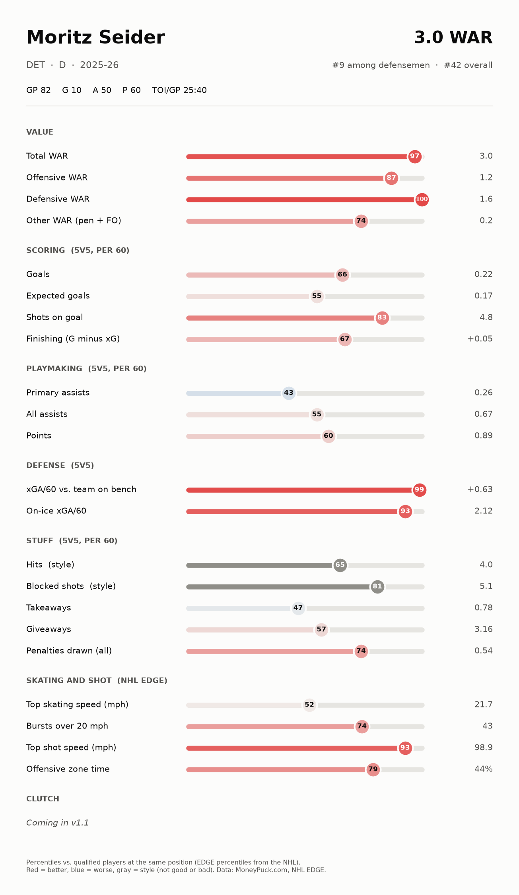
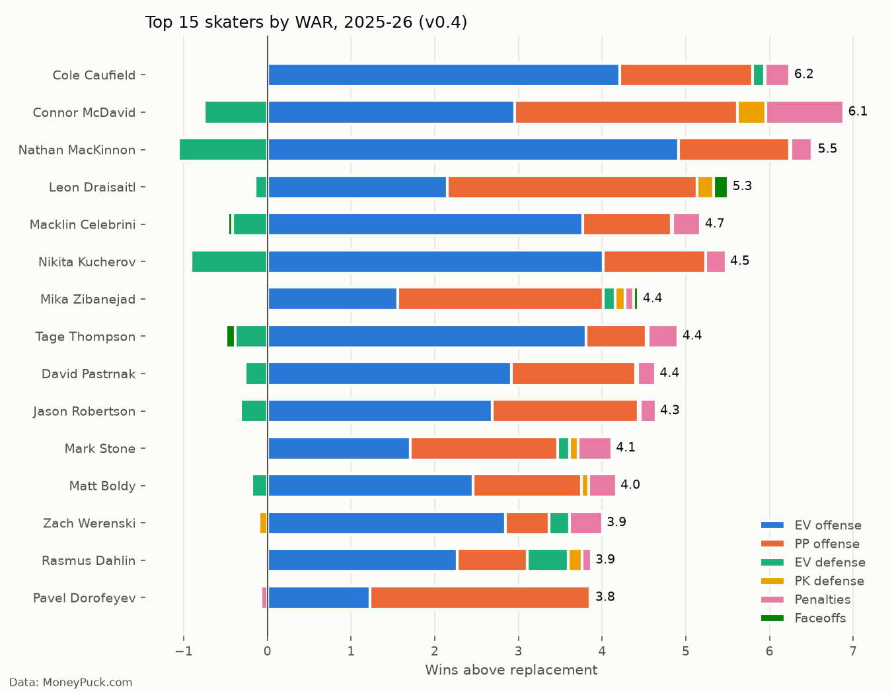
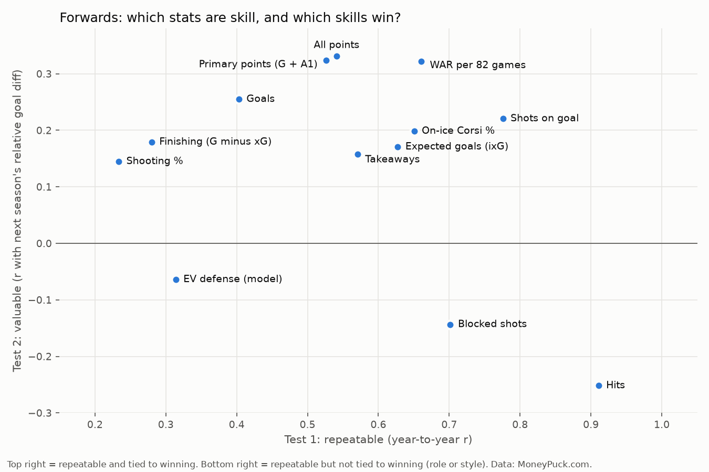

# Hockey WAR: an NHL Almanac and Forecast

Two projects built on public NHL data:

- **Almanac:** how much did each skater help his team win this season? A hockey version of baseball's WAR (Wins Above Replacement), shown on Baseball Savant-style player cards for 2021-22 to 2025-26. **Live at [hockey-almanac.streamlit.app](https://hockey-almanac.streamlit.app/).**
- **Forecast:** projections and EA NHL-style ratings for every player, and a 2026-27 season simulator. It plays the real schedule 10,000 times, lets you make trades or sit players out, and learns from real games every week. It runs on my computer for now, because its inputs are private.

**Status:** WAR model v0.4. Forecast Phase 2 is done, and the simulator updates weekly from real games.

## Player cards



Each card shows WAR (split into offense, defense, and other) plus percentile bars for scoring, playmaking, defense, "stuff" (hits, blocks, takeaways), and skating and shot speed from NHL EDGE.
- **Percentiles** compare a player to qualified players at his position (200+ minutes at 5-on-5). Players below that still get a card, drawn faint.
- **Red = better, blue = worse.** Gray rows are context, not a rating: style stats like hits, and team-driven stats like on-ice chances against.
- **Giveaways and takeaways are gray (style)** because they mostly track how often a player has the puck, which puts stars near the bottom on giveaways; the rated row is **Takeaway share**, takeaways divided by takeaways plus giveaways, which shows whether his turnovers go his team's way. Before 2024-25, arena scorers recorded these stats very differently and the NHL changed how it records them in 2024-25, so Takeaway share is gray for earlier seasons and never compared across that change.
- **Shot map** at the bottom of the card: where he shot from in the offensive zone (all situations, unblocked shots, net at the top as seen from the point), with goals as dots, plus his unblocked shots, goals, and shooting %. Built from MoneyPuck shot data; only pre-counted 5 ft cells are published.
- **Clutch** section: **win probability added** (how much his goals changed his team's chance of winning) and **expected WPA** (what his shots were worth, given the moments he took them) are rated like any other row. **Clutch vs. his own finishing** (WPA minus what his usual finishing would produce from those same shots) is gray, because it doesn't repeat from season to season; it's shown for players with 100+ unblocked shots.
- **Header** shows age and draft position, so a 20-year-old #2 pick on a bad team reads differently than a 30-year-old veteran.
- **Offensive zone time is hidden for now.** It mostly reflects the team, not the player. It's still calculated and will come back once it's adjusted for team.

## Results (v0.4, 2025-26)



- **Cole Caufield is #1 at 6.2 WAR,** just ahead of Connor McDavid (6.1). Caufield scored about 15 more even-strength goals than expected. Almanac measures what happened, so those goals count. Whether he can repeat it is a Forecast question, but five seasons of data say he is a real finisher: he beat his expected goals in 4 of 5 seasons (+32 total).
- **McDavid is 3rd in power play value** and has 99th-percentile skating speed.
- **Nathan MacKinnon has the most offensive value of anyone** but one of the worst defensive ratings, which keeps him at #3.
- **Moritz Seider has the best defensive rating of any defenseman.**

## What five seasons of data showed



Using 2021-22 to 2025-26, every stat got two tests: is it **repeatable** from one season to the next (skill, not luck), and does it predict **winning** (next season's goal differential)?
- **Points are real skill and tied to winning.** For forwards, points predict next season's goal differential better than expected goals do.
- **Hits and blocks are very repeatable but not tied to winning.** They describe a player's role and style, so they're shown on the card in gray and left out of WAR.
- **Actual goals and expected goals together predict future scoring better than either one alone.** This is the starting point for Forecast.

### Is clutch real?

Every goal was credited with how much it changed his team's chance of winning (win probability added, WPA), using a win probability model trained on 2021-22 to 2023-24 and tested on 2025-26. Year-to-year correlation for the same player (100+ unblocked shots both seasons):

| | Forwards | Defense |
|---|---|---|
| Win probability added | 0.64 | 0.51 |
| Expected WPA (from his shots) | 0.71 | 0.76 |
| Clutch (WPA beyond his own finishing) | 0.07 | 0.06 |

Players who get chances in big moments and finish well keep doing it, but scoring more than his normal finishing would predict in big moments does not carry over from one season to the next.

### Goalies

Goalie WAR (v0, 2008-09 to 2025-26) is goals saved above expected (GSAx), minus what a replacement-level backup would save in the same minutes, converted to wins. Adding it to skater WAR raises the match with team goal differential in every season (average 0.78 to 0.85). It isn't on the cards yet.

Which goalie stats repeat from season to season (1000+ minutes both seasons, each compared to that season's league average, because MoneyPuck's expected goals drift for everyone in recent seasons):

| | All goalies | Changed teams |
|---|---|---|
| Goals saved above expected | 0.12 | -0.11 |
| High-danger GSAx | 0.06 | -0.10 |
| Freezes vs. expected | 0.57 | 0.48 |
| Rebounds vs. expected | 0.29 | 0.09 |
| Save % | 0.14 | -0.08 |

Freezing the puck is the one goalie skill that clearly travels with a goalie to a new team. Stopping more goals than expected barely repeats, so one great season says little about the next.

## Forecast, Phase 1: projections for 2026-27

Almanac says how a player did. Forecast tries to say how he'll do next. Phase 1 (notebooks 15-20) builds the pieces: a projection for every NHL player and drafted prospect, how wide each projection's range should be, and an EA NHL-style rating. Every step is tested the same way: build it on older seasons, then check it on seasons it never saw.

### True talent (notebook 15)

One season is a noisy read on a player. Blending his last three seasons and pulling him toward the average player at his position predicts next season's WAR rate **34% better** than last season alone. Aging curves adjust for where he is in his career: forwards peak around 27, defensemen around 26. Goalies are the exception. Their results barely repeat, so their history is only 2% better than calling every goalie league average.

### NHLe: translating junior, college and European scoring (notebook 16)

Each league gets a factor that turns its scoring into NHL points per game, learned from players who jumped to the NHL the next season. Forwards and defensemen get separate factors where there's enough data, and younger players get a boost because they're still improving. On rookies from 2018-19 on (factors fit only on earlier years), it predicts their scoring **15% better** than calling every rookie the average for his position. A player's pre-NHL record is summed up by his last two seasons, not his best one, because a player's best season is usually his luckiest (notebook 19).

### Development ranges (notebook 17)

Every projection misses. Looking at how far players beat or miss their projection showed that **more than half of a surprise season is luck**: about 55% for a forward over a full season, 60% for a defenseman, and 87% for a goalie. Most of the rest is one-year change like a new role, new linemates or health. Young players and recent top picks beat their projections more often, so their ranges are wider. Tested on 2018-19 onward with ranges built only on earlier seasons, the 90% ranges caught 87-88% of what actually happened.

### Player-specific prior (notebook 18)

The true-talent blend used to pull everyone toward the same average. Now each skater is pulled toward his own expected level, built from his pre-NHL scoring, draft position, age and NHL experience. That lowered the backtest error from **0.273 to 0.267** GAR per 60, and by about **4% for players 23 and under**. It also mostly fixed a pattern from notebook 17, where top picks kept beating their projections.

### Prospects (notebook 19)

Drafted players who haven't made the NHL yet get projections too: **1,167 prospects** from the 2019 to 2026 drafts, based on their last two seasons of scoring. A prospect's projection means "what he'd do if he played NHL minutes this season." For forwards that beat the position average on past rookies. For defensemen nothing did, so defense prospects get the position average.

### OVR ratings (notebook 20)

Every player and prospect gets an EA NHL-style overall rating on a **fixed 40-99 scale**. Projected WAR is first converted to a full-time role at his position, so a 90 forward and a 90 defenseman are worth the same to a team. Replacement level is 70, the median NHL regular is about 80, and **Connor McDavid is 98**. The scale is frozen, so in a multi-year simulation ratings can rise and fall league-wide instead of being reshuffled every season.

### What it doesn't do well yet

- **Goalies cluster high.** Almost every NHL goalie sits well above replacement, so on the skater scale regular goalies would have a median of 88, with 24 of 72 at 90+. Goalies get their own scale instead: regulars run 72 to 95 (median 80), and Logan Thompson tops it at 95. Notebook 21 checked whether the cluster is a model error. It isn't: goalie call-ups sit as far above replacement as skater call-ups, so the cluster is the job's real value. Goalie results still barely repeat, though, so some goalies rate high on little recent work: Carter Hart is 89 after about 1,020 minutes in 2025-26.
- **Defense is the hardest part to measure.** Some defensemen who play heavy minutes rate as replacement level, around 70. Coaches clearly value them more than the model does.
- **Prospect ratings mean "if he plays."** Whether a prospect is actually ready comes later, in the simulator's call-up logic.

**Next:** Phase 2, the season simulator (below).

**Data:** the full projection tables and the downloaded NHL profiles and draft data stay private on my computer. Only the code and notebooks are public.

## Forecast, Phase 2: a 2026-27 season simulator

Phase 2 (notebooks 21-29) turns projections into seasons. The simulator plays all 1,344 games of the real 2026-27 schedule, 10,000 times, with real results locked in and any trades or sit-outs you pick. Then it learns from each week of real games. As in Phase 1, each piece is built on older seasons and checked on seasons it never saw: 2018-19 and 2021-22 to 2025-26.

### Goalie prior (notebook 21)
Goalies now get their own expected level, like skaters in notebook 18: NHL experience, age, and pre-NHL save %, pulled toward average because it barely repeats. The gain is small, as expected for goalies: error from 0.3043 to 0.3015 GAR per 60 on 370 test goalie-seasons.

### Opening-night rosters and the trades log (notebook 22)
Every player's team on opening night (Sept 29, 2026), from an NHL API snapshot: active rosters, AHL and ECHL affiliates, and players whose rights a team holds. All 822 NHL-level players have a projection. Two Detroit disputes are entered by hand: Dylan Larkin and Simon Edvinsson (unsigned RFA in Sweden). The opening-night baseline is a "no disputes" world where both play. In-season trades go in a hand-kept log; the simulator applies the ones you pick.

### Lineups (notebook 23)
Who dresses (12 forwards with 4 natural centers, 6 defensemen, 2 goalies) and how much each plays. A coach score mixes last season's real usage (75%) with the projection (25%), because coaches mostly keep using who they used. On test seasons it gets 82% of each team's real top-6 forwards and 81% of its top-4 defensemen, with minutes off by 1.86 a game for forwards and 2.19 for defensemen.

### The game engine (notebook 24)
Each game's score comes from the two lineups' projected WAR and home ice, plus a table of what really happens late with the goalie pulled, plus overtime and shootouts. It reproduces how games end: 22.1% of test-season games went past regulation, and 22.1% of simulated ones. Each player also gets a random good or bad season from notebook 17's ranges.

### Calibration and the team bonus (notebook 25)
On its own, the simulator lost to a simple baseline: last season's points, pulled one-third toward average. The fix is a team bonus, how much each team beat or missed its players' projections last season, keeping 40% of it. That makes the gaps between teams the right size and beats the baseline (see Accuracy).

### The season runner (notebook 26)
Plays 2026-27 from opening night or any later date:
- **Locked in:** real results before the start date. They match the NHL standings for all 32 teams.
- **Applied:** the trades and sit-outs you pick. Lineups stay fixed from the start date.
- **Goalies:** the backup starts back-to-backs and about 30 of 84 games.
- **Playoffs:** the NHL format, top 3 in each division plus 2 wild cards per conference.
- **Speed:** 10,000 seasons take about 5 seconds.

### Stat lines (notebook 27)
Every simulated season also has goals and assists. A team's goals go to its skaters by projected goals per 60 and minutes, and a player's scoring moves with his random season, so a breakout in WAR is a breakout in points. The goals-per-60 projection has a test error of 0.238 (last season alone: 0.349), and 81.8% of real point totals land in the simulated 80% range. After opening night, a stat line is real stats so far plus the simulated rest.

### In-season learning (notebook 28)
My idea: a player's random season is a guess, and real games can weigh the guesses. Each player gets 3,000 guesses from his preseason range, and guesses that make his real goals and assists so far more likely get more weight (Bayesian updating with a particle filter). Small samples move a little, big ones more: Cutter Gauthier doesn't move after 2 goals and 3 assists in 6 games, but after 15 goals and 7 assists in 17 his points per 60 rises 24%. Teams get the same idea: results the players don't explain move the team bonus, counting 17% after 10 games and 45% after 40.

### Weekly refresh and the forecast log (notebook 29)
Once a week, one notebook:
- **Downloads** only new scores and boxscores.
- **Checks them:** every game has a boxscore, and goals match the scores. A roster change that isn't in the trades log blocks the save.
- **Reruns** the update with settings frozen in a file.
- **Saves a dated forecast** that's never overwritten. Each entry records the code version and the evidence it used, so it can be graded later.

The simulator has a switch, "Use 2026-27 results so far", that plays from the newest entry. It reproduces the logged forecast exactly.

## Accuracy

All errors are on test seasons the models never saw (2018-19 and 2021-22 to 2025-26), as root mean squared error.

### The season simulator (notebook 25)

Final team points, predicted before the season:

| Before the season | Error (points) | Correlation | Gap size (1.00 = right) |
|---|---|---|---|
| Every team at league average | 16.40 | - | - |
| Last season, pulled 1/3 to average | 13.56 | 0.55 | 0.81 |
| Simulator alone | 14.38 | 0.51 | 1.41 |
| **Simulator + team bonus (used)** | **13.23** | **0.57** | **1.00** |
| Simulator 40% + last season 60% | 13.06 | 0.59 | 1.17 |

Said plainly: the blend versions were slightly more accurate (13.02 to 13.07), and the training seasons picked one of them. I used the team bonus anyway. The gap is within noise, and the blend keeps only 40% of a roster move, while trades and sit-outs are what the simulator is for.

### Learning from this season's games (notebook 28)

Rest-of-season error after 10, 20 and 40 games. "Pace" means the rate so far, carried over the rest of the season.

| Players (points) | Preseason | Pace | **Update** |
|---|---|---|---|
| After 10 games | 8.0 | 18.5 | **7.9** |
| After 20 games | 7.2 | 11.8 | **7.0** |
| After 40 games | 5.5 | 6.8 | **5.3** |

| Teams (points) | Preseason | Pace | **Update** |
|---|---|---|---|
| After 10 games | 12.1 | 24.1 | **11.6** |
| After 20 games | 11.2 | 15.0 | **10.4** |
| After 40 games | 8.6 | 8.2 | **7.4** |

The rule to adopt it: it had to beat both preseason and pace at every cutoff. It did, and the training seasons (2013-14 to 2017-18) agree. The gain is small early, because 10 games of evidence moves a forecast very little.

### Tested and not adopted

- **The goalie update** (from goals saved above expected so far): goalie predictions barely changed (after 10 games, error 0.0561 with it vs. 0.0559 without). It also made team predictions worse at every cutoff: 12.2 vs. 11.8 points after 10 games, and 7.2 vs. 7.0 after 40 (2021-22 to 2025-26). It's off.
- **Skater WAR so far as evidence:** past seasons here only have season totals, so WAR after 10, 20 or 40 games can't be rebuilt to test it. It's logged as a second version, never the default.
- **Separating talent from luck in each guess** (the "split" version): a near tie with the simpler "whole" version. Average points error over the three cutoffs: training 6.176 (whole) vs. 6.181 (split), test 6.713 vs. 6.695. Training picked whole and test leaned split, by less than 0.02 points. I kept the simpler one.

## The Detroit experiment

Detroit's 2026-27 has two disputes. Dylan Larkin asked for a trade in September, missed Detroit's first 2 games, then played 10 (Oct 6 to Oct 26), and was suspended without pay on Oct 29 after saying he would no longer play for the team. Simon Edvinsson is an unsigned RFA in Sweden and hasn't played. The simulator can sit them out and show what it costs.

**What-ifs from opening night** (10,000 seasons, notebook 26). These are hypothetical: in reality Larkin played 10 of Detroit's first 12 games.

| Detroit | Points (change) | 10th to 90th | Playoffs |
|---|---|---|---|
| Both play | 91.2 | 74 to 109 | 40.2% |
| What if Larkin sits | 87.7 (-3.5) | 70 to 106 | 31.2% |
| What if Edvinsson sits | 90.4 (-0.8) | 72 to 108 | 38.2% |
| What if both sit | 86.8 (-4.4) | 69 to 105 | 29.1% |

**The real season.** Real results so far are locked in, including Larkin's 10 games. From the start date on, both sit, with trades T1-T6. Detroit was 7-8-3 through Nov 9:

| Forecast | Points (10th to 90th) | Playoffs |
|---|---|---|
| From Nov 10: real results so far, preseason ratings (notebook 26) | 84.5 (70 to 100) | 18.0% |
| From Nov 10: updated with games through Nov 9 (notebook 28) | 80.8 | 10.2% |
| **From Nov 11: updated, as of evidence through Nov 10 (latest log entry)** | **78.8 (65 to 93)** | **7.1%** |

At 17 points in 19 games, Detroit is doing worse than its players' projections explain. So the update lowers its team bonus, and the forecast drops with it.

## How the model changed across versions

| Version | What changed | What it fixed or revealed |
|---|---|---|
| **v0.1** | Even-strength offense, even-strength defense, penalties | 14 of the top 20 were defensemen. MacKinnon was #116, which is obviously wrong. |
| **v0.2** | Added power play, penalty kill, finishing, faceoffs. Defense cut to half weight. | McDavid to #1. Defensemen in the top 20 dropped from 14 to 4. |
| **v0.3** | Finishing weight lowered from 0.5 to 0.3 | Rankings barely moved, which pointed to the defense stat as the bigger issue. |
| **v0.4** | Goals above expected count fully. WAR split into offense, defense, and other. | Team WAR matches team goal differential better than v0.3 (average correlation 0.79 vs. 0.77). Three alternative defense stats were tested; none was meaningfully better. |

## How WAR is calculated

1. **Data:** MoneyPuck season-level skater stats, split into even strength (5v5), power play, and penalty kill. Skating and shot speed, age, and draft position from the NHL's public data.
2. **Components,** each measured in goals above a replacement-level player in the same minutes:
   - Even-strength offense: shot quality created, goals above expected, and primary assists
   - Power play offense: same method, power play minutes only
   - Even-strength defense: how much better the team defends with him on the ice than on the bench (half weight)
   - Penalty kill defense: chances allowed compared to his team's penalty kill (half weight)
   - Penalties drawn minus taken, and faceoffs for centers
3. **Replacement level:** players outside each team's top 13 forwards and 7 defensemen by ice time.
4. **Goals to wins:** about 6 goals of goal differential equals 1 win.

## Notebooks

| # | Notebook | What it does |
|---|---|---|
| 01 | [`data_prep`](notebooks/01_data_prep.ipynb) | Reshape MoneyPuck data, one row per player |
| 02 | [`war_model`](notebooks/02_war_model.ipynb) | v0.1 |
| 03 | [`war_model_v02`](notebooks/03_war_model_v02.ipynb) | v0.2 |
| 04 | [`war_model_v03`](notebooks/04_war_model_v03.ipynb) | v0.3 |
| 05 | [`multi_season`](notebooks/05_multi_season.ipynb) | Five seasons, skill vs. value tests, the Caufield question |
| 06 | [`war_model_v04`](notebooks/06_war_model_v04.ipynb) | v0.4, team validation, defense alternatives |
| 07 | [`player_cards`](notebooks/07_player_cards.ipynb) | Percentile table and the first cards |
| 08 | [`edge_data`](notebooks/08_edge_data.ipynb) | Download NHL EDGE data and player profiles |
| 09 | [`app_data`](notebooks/09_app_data.ipynb) | Slim public card table for the app (only what the card draws) |
| 10 | [`all_seasons`](notebooks/10_all_seasons.ipynb) | Cards for all five seasons, checked against the saved 2025-26 table, and the app's combined table |
| 11 | [`shot_data`](notebooks/11_shot_data.ipynb) | MoneyPuck shot data loaded, checked and saved as Parquet |
| 12 | [`shot_grid`](notebooks/12_shot_grid.ipynb) | Shot map grid: 5 ft cells and totals per player-season, orientation check |
| 13 | [`win_probability`](notebooks/13_win_probability.ipynb) | Win probability model, WPA, expected WPA and Clutch; is clutch repeatable? |
| 14 | [`history_and_goalies`](notebooks/14_history_and_goalies.ipynb) | Skater WAR back to 2008-09; goalie WAR v0 and team check; which goalie stats repeat |
| 15 | [`true_talent_and_aging`](notebooks/15_true_talent_and_aging.ipynb) | True-talent WAR (backtested blend of 3 seasons), aging curves for F, D and G, private 2026-27 projections |
| 16 | [`nhle`](notebooks/16_nhle.ipynb) | NHL equivalencies for pre-NHL leagues, by position and age |
| 17 | [`development_ranges`](notebooks/17_development_ranges.ipynb) | How far players beat or miss their projection: luck vs. change, and range calibration |
| 18 | [`player_specific_prior`](notebooks/18_player_specific_prior.ipynb) | Each skater pulled toward his own expected level |
| 19 | [`prospects`](notebooks/19_prospects.ipynb) | Draft classes 2019-2026, the pre-NHL rule, and 1,167 prospect projections |
| 20 | [`ovr_ratings`](notebooks/20_ovr_ratings.ipynb) | An EA-style 40-99 rating on a frozen scale |
| 21 | [`goalie_prior`](notebooks/21_goalie_prior.ipynb) | Each goalie's own expected level: experience, age and pre-NHL save % |
| 22 | [`opening_night_rosters`](notebooks/22_opening_night_rosters.ipynb) | 2026-27 opening-night teams and statuses, and the trades log |
| 23 | [`lineups`](notebooks/23_lineups.ipynb) | Who dresses and how many minutes, backtested against real usage |
| 24 | [`season_simulator`](notebooks/24_season_simulator.ipynb) | The game engine, and a backtest against real standings |
| 25 | [`simulator_calibration`](notebooks/25_simulator_calibration.ipynb) | Coefficient fits and the team bonus: picked on training seasons, checked on test |
| 26 | [`season_runner`](notebooks/26_season_runner.ipynb) | The 2026-27 runner: real schedule, results so far, trades, sit-outs, playoff odds |
| 27 | [`stat_lines`](notebooks/27_stat_lines.ipynb) | Goals and assists for every simulated season |
| 28 | [`inseason_update`](notebooks/28_inseason_update.ipynb) | Learning from 2026-27 games, backtested after 10, 20 and 40 games |
| 29 | [`weekly_refresh`](notebooks/29_weekly_refresh.ipynb) | Weekly downloads, checks, the frozen update and the dated forecast log |

The model and simulator code live in [`src/`](src/) so every notebook uses the same functions.

## How this was built

**v1** was my own code, written by hand for a class project at Michigan State (CMSE 201, Spring 2025). It's kept in [`archive/`](archive/). It had real problems: made-up weights, a replacement level that was really the average of good players, double-counted stats, a couple of calculation bugs, and an output that wasn't actually in wins.

**v2 (v0.1 onward)** was built with Claude (Anthropic's AI) as a coding partner. Claude wrote most of the code. I chose the questions, made the modeling decisions, reviewed and ran every version, and checked the results against what I know about hockey.

Problems found and decisions made along the way:
- **Stars ranked absurdly low in v0.1** (I caught this). MacKinnon at #116 led to adding special teams and finishing.
- **The defense stat punished stars** (I caught this by comparing components). It's why defense counts at half weight.
- **Caufield at #2 looked suspicious** (I flagged it). Five seasons of data showed he really is an elite finisher, which shaped how v0.4 treats goals.
- **Splitting the project into Almanac and Forecast** (my decision). One-year wonders are real seasons, so single-season WAR should count them. Predicting whether they repeat is a separate job.
- **Penalty kill selection bias** (caught by Claude while testing). The first method rated elite penalty killers below replacement, because top killers take the hardest shifts. It was rebuilt to compare each player against his own team's penalty kill.
- **Mixing forwards and defensemen inflated the repeatability numbers** (caught by Claude). The tests are now run by position.
- **Card review** (me). I checked cards for 10 players I know well. That led to adding age and draft position, counting skating bursts per 60 minutes, and showing team-driven stats as context instead of a rating.
- **The team bonus over the more accurate blend** (my decision). See Accuracy: the gap was within noise, and the blend would have muted every trade and sit-out.
- **In-season learning** (my idea). Treat each player's random season as a guess and let real games weigh the guesses. When the backtest was a tie between two versions, I kept the simpler one.
- **Roster changes block the weekly save** (my rule). A trade or waiver claim the log doesn't know about would make the forecast quietly wrong, so the notebook refuses to save until it's logged.

## Limitations

**Almanac**
- The defense stat partly measures linemates and opponents, not just the player. Fixing that needs shift-level data.
- Constants (goals per win, penalty value, faceoff value, assist weight) are approximations.
- Goalie WAR exists (notebook 14) but isn't on the cards yet.
- Traded players are listed under their final team. Their stats cover the full season, but the replacement-level and penalty kill comparisons only use the last team.

**Forecast**
- **Defense is still the hardest part to measure.** Some heavy-minute defensemen rate as replacement level.
- **Elite scorers project low.** Projections pull everyone toward average, so the best players start too low. McDavid was projected at 4.18 points per 60; after 19 games the update had him at 5.39.
- **Full health.** Lineups are fixed at the start date, with no injuries or call-ups during a simulated season, so a dressed player plays every game and his totals run a little high.
- **Goalies don't learn in-season.** The goalie update was tested and rejected (see Accuracy).
- **Local only.** The simulator needs private data, so the live site shows the Almanac.
- **Not graded yet.** The weekly forecasts will be scored against real results once there are enough of them.

## Roadmap

**Almanac v1.0**
- [x] Single-season WAR, split into offense, defense, and other
- [x] Player cards with percentiles, faint below the sample threshold
- [x] Skating and shot speed (NHL EDGE), age, and draft position
- [x] Search any player and see his card (Streamlit app)
- [x] All five seasons (2021-22 to 2025-26)
- [x] Live at a public link

**Almanac app, after v1.0**
- [x] Season picker (needs all five seasons)
- [ ] Filters by team and position
- [x] Compare two players, with the better stat highlighted
- [ ] Phone-friendly card layout
- [ ] Bring back offensive zone time, once it's adjusted for team
- [ ] Road-games-only takeaway share for 2021-22 to 2023-24 (removes arena scorer bias)

- [x] **Almanac v1.1:** clutch from win probability (WPA, expected WPA, and clutch vs. his own finishing), tested for whether clutch is a repeatable skill or a story fans tell. It isn't repeatable (see "Is clutch real?").

**Forecast**
- [x] True talent (regression to the mean) and aging curves
- [x] Phase 1: NHLe, development ranges, player-specific prior, prospects and OVR ratings
- [x] Phase 2: season simulator, stat lines, in-season learning, weekly forecast log
- [ ] Level 2: grade the logged forecasts against real results, once there are 4 to 6 weekly entries
- [ ] Matchup simulator: one game, two lineups
- [ ] A public simulator on the live site
- [ ] Make your own trades in the app
- [ ] Multi-season franchise mode (the frozen OVR scale was built for this)

## Data

- **[MoneyPuck.com](https://moneypuck.com/data.htm):** season-level skater stats and shot data. Raw data is not included in this repo (see [`data/README.md`](data/README.md)).
- **NHL EDGE and player profiles** (api-web.nhle.com): downloaded by notebook 08 and kept locally.
- **NHL draft classes** (records.nhl.com) and prospect profiles: downloaded by notebook 19 and kept locally.
- **2026-27 rosters, schedules, daily scores and boxscores** (api-web.nhle.com): downloaded by notebooks 22 and 26-29 and kept locally, along with the forecast log.

**Credit:** player stats from MoneyPuck.com. Skating, shot speed, player profiles, rosters, schedules and boxscores from the NHL.

## Tools

Python (pandas, NumPy, SciPy, matplotlib), Streamlit, Jupyter, VS Code, Git. Built with Claude as a coding partner.

## Repo structure

```
hockey-war/
├── app.py            Streamlit app: Almanac and Forecast pages
├── app_pages/        the pages, including the Forecast page's Simulator tab
├── app_data/         slim public card table the live app reads
├── archive/          original class version (v1)
├── data/             MoneyPuck and NHL data, projections, the forecast log (private, not tracked)
├── images/           charts and player cards generated by the notebooks
├── notebooks/        one notebook per step (01-29)
├── src/              shared code (below)
├── requirements.txt  what the live app needs
└── README.md
```

`src/`:
- **WAR and cards:** `war_model.py`, `goalie_war.py`, `win_prob.py`, `player_card.py`, `compare.py`, `edge_data.py` (NHL downloads)
- **Projections:** `forecast.py`, `nhle.py`, `development.py`, `ratings.py`
- **Simulator:** `lineups.py`, `simulate.py`, `season.py`, `scoring.py`, `inseason.py`, `refresh.py`

## Author

Ryan Campbell, Michigan State University '26 (B.S. Psychology, minors in Quantitative Data Analytics and Spanish)
