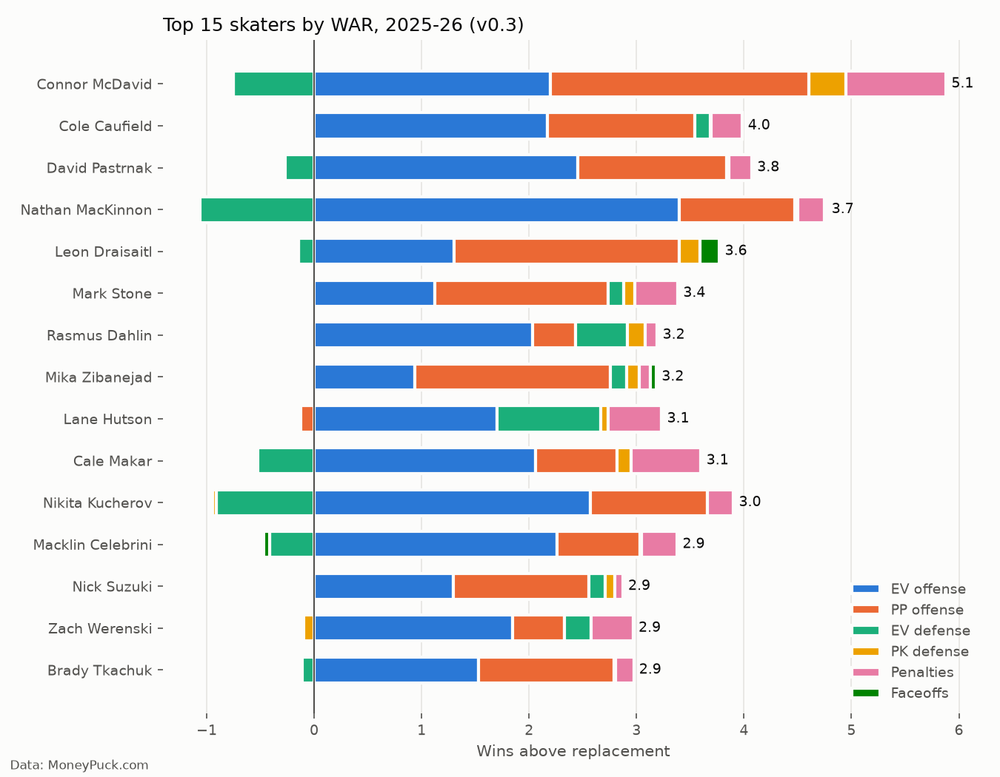
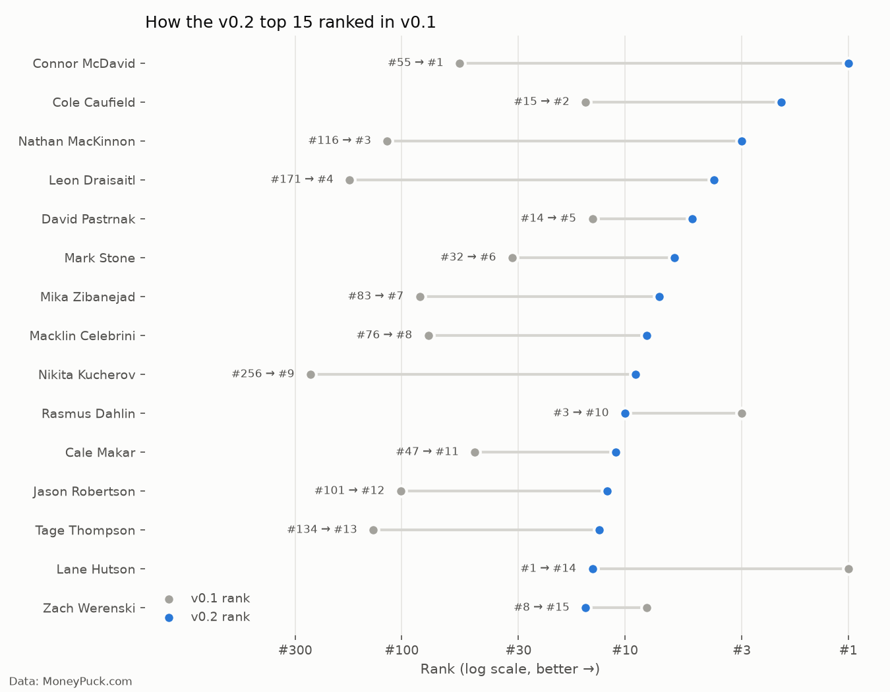

# Hockey WAR: Wins Above Replacement for NHL Skaters

**Status: in progress. Current model: v0.3 (2025-26 season)**

Can one number capture how much a hockey player is worth to his team, combining offense, defense, special teams, and discipline, and express it in wins? Baseball has WAR (Wins Above Replacement). This project builds a simplified hockey version from public data.

## Results (v0.3)



**Key findings so far:**
- **Connor McDavid is #1 at 5.1 WAR**, more than a full win ahead of #2. He leads the league in power play value and is 7th in even-strength offense.
- **Cole Caufield ranks #2**, driven by 33 even-strength goals on about 18 expected goals. Scoring that far above expected rarely repeats, so this is the result I trust least. Multi-season data should settle it.
- **Elite defensemen took a hit once the model got more careful.** Lane Hutson was #1 in v0.1 and is #9 now, mostly because the defense measurement was cut to half weight for being noisy.
- **The defense stat is the model's weakest piece.** It penalizes stars who face the other team's top lines. Nathan MacKinnon is #1 in even-strength offense but ranks 932nd of 940 in even-strength defense, which holds him at #4 overall.

## How the model changed across versions

Each version changes one or two things so the effect of every change is visible. The chart shows where the v0.2 top 15 ranked in v0.1.



| Version | What changed | What it fixed or revealed |
|---|---|---|
| **v0.1** | Even-strength offense, even-strength defense, penalties | 14 of the top 20 were defensemen. MacKinnon was #116 and Kucherov #256, which is obviously wrong. |
| **v0.2** | Added power play, penalty kill, finishing, faceoffs. Defense cut to half weight. | McDavid to #1, MacKinnon to #3. Defensemen in the top 20 dropped from 14 to 4. |
| **v0.3** | Finishing weight lowered from 0.5 to 0.3 | Rankings barely moved (rank correlation 0.99 with v0.2). Caufield stayed #2, which pointed to the defense stat as the bigger issue. |

Full notebooks: [`01_data_prep`](notebooks/01_data_prep.ipynb), [`02_war_model`](notebooks/02_war_model.ipynb) (v0.1), [`03_war_model_v02`](notebooks/03_war_model_v02.ipynb), [`04_war_model_v03`](notebooks/04_war_model_v03.ipynb).

## How it works

1. **Data:** MoneyPuck season-level skater stats, split into even strength (5v5), power play, and penalty kill.
2. **Components,** each measured in goals above a replacement-level player in the same minutes:
   - Even-strength offense: shot quality created, finishing, and primary assists
   - Power play offense: same method, power play minutes only
   - Even-strength defense: how much better the team defends with him on the ice than on the bench (half weight)
   - Penalty kill defense: on-ice chances allowed compared to his team's PK (half weight)
   - Penalties drawn minus taken, and faceoffs for centers
3. **Replacement level:** players outside each team's top 13 forwards and 7 defensemen by ice time.
4. **Goals to wins:** about 6 goals of goal differential equals 1 win.

## How this was built

**v1** was my own code, written by hand for a class project at Michigan State (CMSE 201, Spring 2025). It's kept in [`archive/`](archive/). It had real problems: made-up weights, a replacement level that was really the average of good players, double-counted stats, a couple of calculation bugs, and an output that wasn't actually in wins.

**v2 (v0.1 to v0.3)** was built with Claude (Anthropic's AI) as a coding partner. Claude wrote most of the code. I chose the questions, made the modeling decisions, reviewed and ran every version, and checked the results against what I know about hockey.

Problems found along the way:
- **Stars ranked absurdly low in v0.1** (I caught this). MacKinnon at #116 led to adding special teams and finishing.
- **The defense stat punished stars** (I caught this by comparing components). It's why defense now counts at half weight.
- **Caufield at #2 looked suspicious** (I caught this). It led to lowering the finishing weight in v0.3, and showed the defense stat was the real issue.
- **Penalty kill selection bias** (caught by Claude while testing). The first penalty kill method rated elite penalty killers below replacement, because top killers take the hardest shifts and fringe killers get easy ones. It was rebuilt to compare each player against his own team's penalty kill.

## Limitations

- The defense stat partly measures linemates and quality of competition, not just the player.
- One season of data. Finishing in particular is noisy year to year.
- Constants (goals per win, penalty value, faceoff value, assist and finishing weights) are approximations.
- Goalies are not included. Traded players are listed under one team.

## Roadmap

The end goal is a web app where you can manage an NHL team up to 3 seasons into the future:

- **Multi-season data and a reusable model** (next)
- **Fix the defense metric** (v0.4)
- **Aging curves:** project how players improve or decline with age
- **Bust / breakout factor:** model the uncertainty for young players
- **Player cards:** percentile breakdowns for each player
- **Team builder:** make trades and sign contracts, then see how projected team WAR and cap space change
- **Season simulator:** simulate seasons up to 3 years out based on the roster you build

## Data

Data comes from [MoneyPuck.com](https://moneypuck.com/data.htm). Raw data is not included in this repo. To run the notebooks, download the 2025-26 season-level skaters CSV from MoneyPuck and save it in `data/` (see [`data/README.md`](data/README.md)).

**Credit:** All player data is from MoneyPuck.com.

## Tools

Python (pandas, NumPy, matplotlib), Jupyter, VS Code, Git. Built with Claude as a coding partner.

## Repo structure

```
hockey-war/
├── archive/      original class version (v1)
├── data/         put the MoneyPuck CSV here (not tracked)
├── images/       charts generated by the notebooks
├── notebooks/    v2 analysis, one notebook per step or version
└── README.md
```

## Author

Ryan Campbell, Michigan State University '26 (B.S. Psychology, minors in Quantitative Data Analytics and Spanish)
