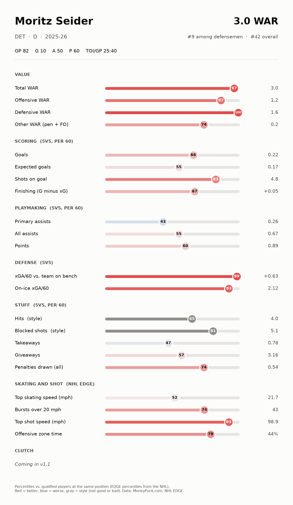
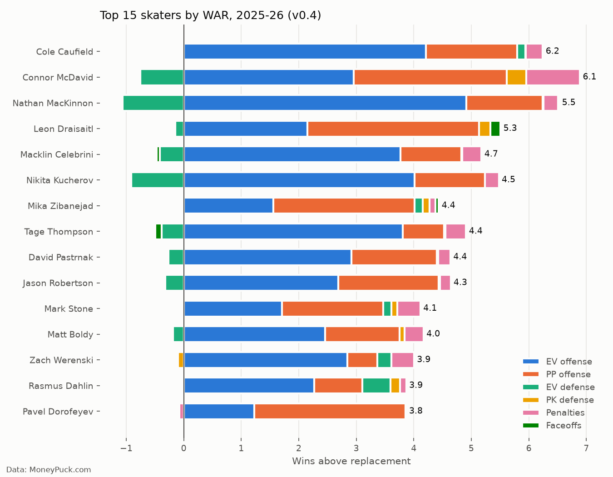
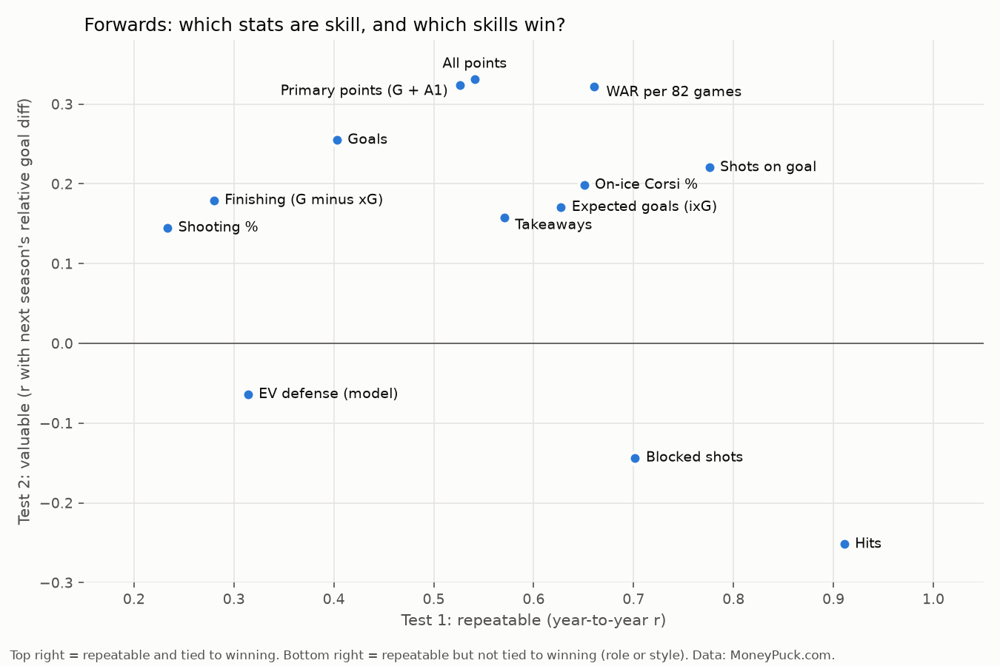

# Hockey WAR: Wins Above Replacement for NHL Skaters

**Status: in progress. Current model: v0.4. Player cards: 2021-22 to 2025-26.**

**Live app: [hockey-almanac.streamlit.app](https://hockey-almanac.streamlit.app/).** Search any 2021-22 to 2025-26 skater and see his card.

Can one number capture how much a hockey player helped his team win in a season, combining offense, defense, special teams, and discipline? Baseball has WAR (Wins Above Replacement). This project builds a hockey version from public data, then puts it on Baseball Savant-style player cards.

The project has two parts:

| | **Almanac** (now) | **Forecast** (later) |
|---|---|---|
| Question | How well did he play *this season*? | How will he play *next season*? |
| Output | Single-season WAR and player cards | Projections with a best case, worst case, and most likely range |
| Data | One season at a time | Career history, aging curves, regression to the mean |

## Player cards



Each card shows WAR (split into offense, defense, and other) plus percentile bars for scoring, playmaking, defense, "stuff" (hits, blocks, takeaways), and skating and shot speed from NHL EDGE.
- **Percentiles** compare a player to qualified players at his position (200+ minutes at 5-on-5). Players below that still get a card, drawn faint.
- **Red = better, blue = worse.** Gray rows are context, not a rating: style stats like hits, and team-driven stats like on-ice chances against.
- **Giveaways and takeaways are gray (style)** because they mostly track how often a player has the puck, which puts stars near the bottom on giveaways; the rated row is **Takeaway share**, takeaways divided by takeaways plus giveaways, which shows whether his turnovers go his team's way. Before 2024-25, arena scorers recorded these stats very differently and the NHL changed how it records them in 2024-25, so Takeaway share is gray for earlier seasons and never compared across that change.
- **Shot map** at the bottom of the card: where he shot from in the offensive zone (all situations, unblocked shots, net at the top as seen from the point), with goals as dots, plus his unblocked shots, goals, and shooting %. Built from MoneyPuck shot data; only pre-counted 5 ft cells are published.
- **Clutch** section: **win probability added** (how much his goals changed his team's chance of winning) and **expected WPA** (what his shots were worth, given the moments he took them) are rated like any other row. **Clutch vs. his own finishing** (WPA minus what his usual finishing would produce from those same shots) is gray, because it doesn't repeat from season to season; it's shown for players with 100+ unblocked shots.
- **Header** shows age and draft position, so a 20-year-old #2 pick on a bad team reads differently than a 30-year-old veteran.
- **Offensive zone time is hidden for now.** It mostly reflects the team, not the player. It's still calculated and will come back once it's adjusted for team.

## Results (v0.4, 2025-26)



- **Cole Caufield is #1 at 6.2 WAR,** just ahead of Connor McDavid (6.1). Caufield scored about 15 more even-strength goals than expected. Almanac measures what happened, so those goals count. Whether he can repeat it is a Forecast question, but five seasons of data say he is a real finisher: he beat his expected goals in 4 of 5 seasons (+32 total).
- **McDavid is 3rd in power play value** and has 99th-percentile skating speed.
- **Nathan MacKinnon has the most offensive value of anyone** but one of the worst defensive ratings, which keeps him at #3.
- **Moritz Seider has the best defensive rating of any defenseman.**

## What five seasons of data showed



Using 2021-22 to 2025-26, every stat got two tests: is it **repeatable** from one season to the next (skill, not luck), and does it predict **winning** (next season's goal differential)?
- **Points are real skill and tied to winning.** For forwards, points predict next season's goal differential better than expected goals do.
- **Hits and blocks are very repeatable but not tied to winning.** They describe a player's role and style, so they're shown on the card in gray and left out of WAR.
- **Actual goals and expected goals together predict future scoring better than either one alone.** This is the starting point for Forecast.

### Is clutch real?

Every goal was credited with how much it changed his team's chance of winning (win probability added, WPA), using a win probability model trained on 2021-22 to 2023-24 and tested on 2025-26. Year-to-year correlation for the same player (100+ unblocked shots both seasons):

| | Forwards | Defense |
|---|---|---|
| Win probability added | 0.64 | 0.51 |
| Expected WPA (from his shots) | 0.71 | 0.76 |
| Clutch (WPA beyond his own finishing) | 0.07 | 0.06 |

Players who get chances in big moments and finish well keep doing it, but scoring more than his normal finishing would predict in big moments does not carry over from one season to the next.

### Goalies

Goalie WAR (v0, 2008-09 to 2025-26) is goals saved above expected (GSAx), minus what a replacement-level backup would save in the same minutes, converted to wins. Adding it to skater WAR raises the match with team goal differential in every season (average 0.78 to 0.85). It isn't on the cards yet.

Which goalie stats repeat from season to season (1000+ minutes both seasons, each compared to that season's league average, because MoneyPuck's expected goals drift for everyone in recent seasons):

| | All goalies | Changed teams |
|---|---|---|
| Goals saved above expected | 0.12 | -0.11 |
| High-danger GSAx | 0.06 | -0.10 |
| Freezes vs. expected | 0.57 | 0.48 |
| Rebounds vs. expected | 0.29 | 0.09 |
| Save % | 0.14 | -0.08 |

Puck handling after the save (freezing the puck instead of giving up rebounds) is a real, portable goalie skill. Stopping more goals than expected barely repeats, so one great season says little about the next.

### Forecast: true talent and aging

- **Three seasons beat one.** Blending a skater's last 3 seasons and pulling him toward his position's average (1,500 minutes' worth) predicts next season's WAR rate 34% better than last season alone (error 0.268 vs. 0.404 GAR per 60, backtested on 14 seasons from 2009-10 to 2025-26).
- **Goalies barely beat average.** The best goalie blend is only 2% better than calling every goalie league average.
- **Aging:** forwards decline faster each year as they age (about -0.05 WAR per 1,000 minutes at 25, -0.15 at 30, -0.19 at 33); defensemen decline slowly and evenly. The curves understate early-career growth because players who keep their jobs tend to regress, so the slopes matter more than the peak ages. Aging lowered the backtest error by about 1% for skaters and not at all for goalies.
- Projections stay private for now.

## How the model changed across versions

| Version | What changed | What it fixed or revealed |
|---|---|---|
| **v0.1** | Even-strength offense, even-strength defense, penalties | 14 of the top 20 were defensemen. MacKinnon was #116, which is obviously wrong. |
| **v0.2** | Added power play, penalty kill, finishing, faceoffs. Defense cut to half weight. | McDavid to #1. Defensemen in the top 20 dropped from 14 to 4. |
| **v0.3** | Finishing weight lowered from 0.5 to 0.3 | Rankings barely moved, which pointed to the defense stat as the bigger issue. |
| **v0.4** | Goals above expected count fully. WAR split into offense, defense, and other. | Team WAR matches team goal differential better than v0.3 (average correlation 0.79 vs. 0.77). Three alternative defense stats were tested; none was meaningfully better. |

## How it works

1. **Data:** MoneyPuck season-level skater stats, split into even strength (5v5), power play, and penalty kill. Skating and shot speed, age, and draft position from the NHL's public data.
2. **Components,** each measured in goals above a replacement-level player in the same minutes:
   - Even-strength offense: shot quality created, goals above expected, and primary assists
   - Power play offense: same method, power play minutes only
   - Even-strength defense: how much better the team defends with him on the ice than on the bench (half weight)
   - Penalty kill defense: chances allowed compared to his team's penalty kill (half weight)
   - Penalties drawn minus taken, and faceoffs for centers
3. **Replacement level:** players outside each team's top 13 forwards and 7 defensemen by ice time.
4. **Goals to wins:** about 6 goals of goal differential equals 1 win.

## Notebooks

| # | Notebook | What it does |
|---|---|---|
| 01 | [`data_prep`](notebooks/01_data_prep.ipynb) | Reshape MoneyPuck data, one row per player |
| 02 | [`war_model`](notebooks/02_war_model.ipynb) | v0.1 |
| 03 | [`war_model_v02`](notebooks/03_war_model_v02.ipynb) | v0.2 |
| 04 | [`war_model_v03`](notebooks/04_war_model_v03.ipynb) | v0.3 |
| 05 | [`multi_season`](notebooks/05_multi_season.ipynb) | Five seasons, skill vs. value tests, the Caufield question |
| 06 | [`war_model_v04`](notebooks/06_war_model_v04.ipynb) | v0.4, team validation, defense alternatives |
| 07 | [`player_cards`](notebooks/07_player_cards.ipynb) | Percentile table and the first cards |
| 08 | [`edge_data`](notebooks/08_edge_data.ipynb) | Download NHL EDGE data and player profiles |
| 09 | [`app_data`](notebooks/09_app_data.ipynb) | Slim public card table for the app (only what the card draws) |
| 10 | [`all_seasons`](notebooks/10_all_seasons.ipynb) | Cards for all five seasons, checked against the saved 2025-26 table, and the app's combined table |
| 11 | [`shot_data`](notebooks/11_shot_data.ipynb) | MoneyPuck shot data loaded, checked and saved as Parquet |
| 12 | [`shot_grid`](notebooks/12_shot_grid.ipynb) | Shot map grid: 5 ft cells and totals per player-season, orientation check |
| 13 | [`win_probability`](notebooks/13_win_probability.ipynb) | Win probability model, WPA, expected WPA and Clutch; is clutch repeatable? |
| 14 | [`history_and_goalies`](notebooks/14_history_and_goalies.ipynb) | Skater WAR back to 2008-09; goalie WAR v0 and team check; which goalie stats repeat |
| 15 | [`true_talent_and_aging`](notebooks/15_true_talent_and_aging.ipynb) | True-talent WAR (backtested blend of 3 seasons), aging curves for F, D and G, private 2026-27 projections |

The model and card code live in [`src/`](src/) so every notebook uses the same functions.

## How this was built

**v1** was my own code, written by hand for a class project at Michigan State (CMSE 201, Spring 2025). It's kept in [`archive/`](archive/). It had real problems: made-up weights, a replacement level that was really the average of good players, double-counted stats, a couple of calculation bugs, and an output that wasn't actually in wins.

**v2 (v0.1 onward)** was built with Claude (Anthropic's AI) as a coding partner. Claude wrote most of the code. I chose the questions, made the modeling decisions, reviewed and ran every version, and checked the results against what I know about hockey.

Problems found and decisions made along the way:
- **Stars ranked absurdly low in v0.1** (I caught this). MacKinnon at #116 led to adding special teams and finishing.
- **The defense stat punished stars** (I caught this by comparing components). It's why defense counts at half weight.
- **Caufield at #2 looked suspicious** (I flagged it). Five seasons of data showed he really is an elite finisher, which shaped how v0.4 treats goals.
- **Splitting the project into Almanac and Forecast** (my decision). One-year wonders are real seasons, so single-season WAR should count them. Predicting whether they repeat is a separate job.
- **Penalty kill selection bias** (caught by Claude while testing). The first method rated elite penalty killers below replacement, because top killers take the hardest shifts. It was rebuilt to compare each player against his own team's penalty kill.
- **Mixing forwards and defensemen inflated the repeatability numbers** (caught by Claude). The tests are now run by position.
- **Card review** (me). I checked cards for 10 players I know well. That led to adding age and draft position, counting skating bursts per 60 minutes, and showing team-driven stats as context instead of a rating.

## Limitations

- The defense stat partly measures linemates and opponents, not just the player. Fixing that needs shift-level data.
- Constants (goals per win, penalty value, faceoff value, assist weight) are approximations.
- Goalie WAR exists (notebook 14) but isn't on the cards yet.
- Traded players are listed under their final team. Their stats cover the full season, but the replacement-level and penalty kill comparisons only use the last team.

## Roadmap

**Almanac v1.0**
- [x] Single-season WAR, split into offense, defense, and other
- [x] Player cards with percentiles, faint below the sample threshold
- [x] Skating and shot speed (NHL EDGE), age, and draft position
- [x] Search any player and see his card (Streamlit app)
- [x] All five seasons (2021-22 to 2025-26)
- [x] Live at a public link

**Almanac app, after v1.0**
- [x] Season picker (needs all five seasons)
- [ ] Filters by team and position
- [x] Compare two players, with the better stat highlighted
- [ ] Phone-friendly card layout
- [ ] Bring back offensive zone time, once it's adjusted for team
- [ ] Road-games-only takeaway share for 2021-22 to 2023-24 (removes arena scorer bias)

- [x] **Almanac v1.1:** clutch from win probability (WPA, expected WPA, and clutch vs. his own finishing), tested for whether clutch is a repeatable skill or a story fans tell. It isn't repeatable (see "Is clutch real?").

**Forecast**
- [x] True talent (regression to the mean) and aging curves
- [ ] Projection ranges, then a team builder and a season simulator

## Data

- **[MoneyPuck.com](https://moneypuck.com/data.htm):** season-level skater stats. Raw data is not included in this repo (see [`data/README.md`](data/README.md)).
- **NHL EDGE and player profiles** (api-web.nhle.com): downloaded by notebook 08 and kept locally.

**Credit:** player stats from MoneyPuck.com. Skating, shot speed, and player profiles from the NHL.

## Tools

Python (pandas, NumPy, matplotlib), Jupyter, VS Code, Git. Built with Claude as a coding partner.

## Repo structure

```
hockey-war/
├── archive/      original class version (v1)
├── data/         MoneyPuck CSVs and downloaded NHL data go here (not tracked)
├── images/       charts and player cards generated by the notebooks
├── notebooks/    analysis, one notebook per step or version
├── src/          WAR model, player card, and NHL data code
└── README.md
```

## Author

Ryan Campbell, Michigan State University '26 (B.S. Psychology, minors in Quantitative Data Analytics and Spanish)
